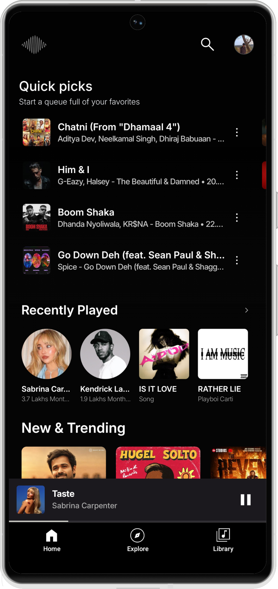
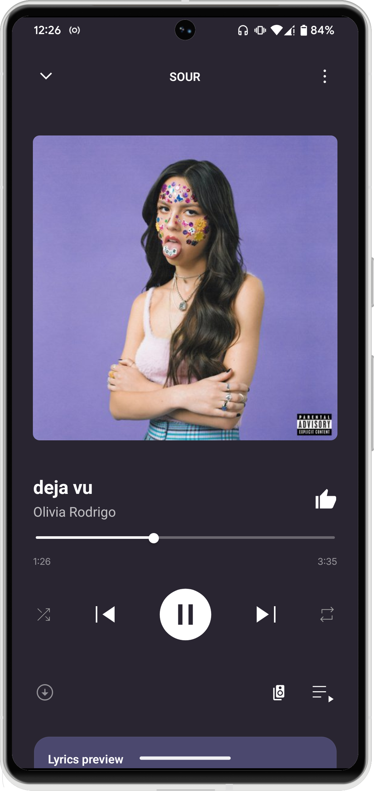
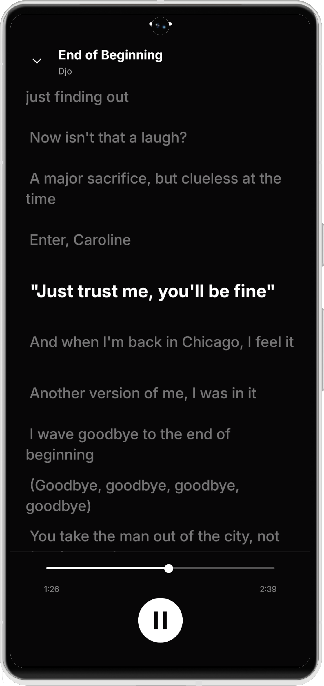
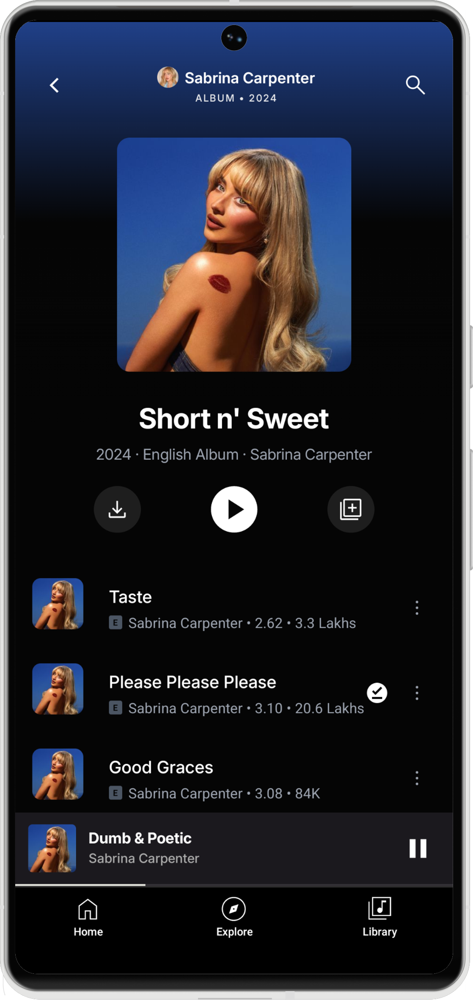
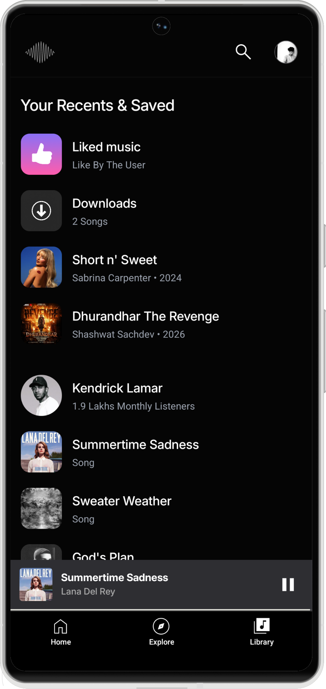

<div align="center">

  

  <h1>Beats</h1>

  <p><b>A modern, high-performance open-source music streaming app built with React Native for Android.</b></p>

  <p>
    <a href="https://github.com/alokkkxpixel/Beats/releases/latest"></a>
    <a href="https://github.com/alokkkxpixel/Beats/releases"></a>
    <a href="https://github.com/alokkkxpixel/Beats/stargazers"></a>
    <a href="LICENSE"></a>
  </p>

  <h3>
    <a href="#-download--installation">Download APK</a> •
    <a href="#-features">Features</a> •
    <a href="#-screenshots">Screenshots</a> •
    <a href="#-architecture--tech-stack">Tech Stack</a> •
    <a href="#-getting-started">Getting Started</a>
  </h3>

  <br/>

  <!-- Main 2 Hero Mockups: Responsive side-by-side or stacked on narrow viewports -->
  <p align="center">
    <a href="https://github.com/alokkkxpixel/Beats/releases/latest">
      
    </a>
    <a href="https://github.com/alokkkxpixel/Beats/releases/latest">
      
    </a>
  </p>

</div>

---

## 🎵 About Beats

**Beats** is an elegant, ad-free, open-source music streaming client crafted for true audiophiles and music lovers. Powered by **React Native**, **Nitro Modules**, and **TanStack Query**, it offers lightning-quick streaming, 320kbps high-fidelity audio, synchronized time-coded lyrics, smooth background playback, seamless offline storage, and instantaneous Over-The-Air (OTA) updates.

---

## ✨ Features

### 🎧 Audio & Playback Engine

- **High-Fidelity Audio:** Stream audio up to **320kbps** with configurable streaming and download qualities (96kbps, 160kbps, 320kbps).
- **High-Performance Audio Engine:** Powered by `react-native-nitro-player` for low-latency buffering, gapless playback stability, lock screen media controls, and notification sync.
- **Smart Queue & Dynamic Recommendations:** Infinite queue generation with auto-recommended tracks matching the active genre and vibes.
- **Sleep Timer & Playback Controls:** Configurable sleep timer, quick seek, loop one/all, and shuffle modes.

### 🎨 Modern & Polished Interface

- **Clean Dark-Mode Aesthetic:** Pure `#050505` OLED-friendly dark styling with Inter typography and butter-smooth transitions.
- **Real-Time Synced Lyrics:** Smooth, time-synchronized karaoke-style lyric scrolling powered by the LRCLIB ecosystem.
- **Personalized Feeds & Regional Mixes:** Multi-language curation (Hindi, English, Punjabi, Tamil, Telugu, and more) plus City Top Hits, Trending Charts, and Curated Playlists.

### 💾 Library, Downloads & Offline Resilience

- **True Offline Mode:** Download tracks directly to device storage with complete metadata, album covers, and instant offline playback.
- **Favorites & Local Playlists:** Create custom playlists, mark liked tracks, and track recently played history.
- **Storage & Cache Management:** Built-in settings dashboard to inspect storage usage and wipe search or query caches with a single tap.

### ⚡ Seamless Updates & Cloud Sync

- **Over-The-Air (OTA) Updates:** Get the latest enhancements and bug fixes instantly without needing to manually reinstall APKs.
- **Clerk Authentication:** Optional cloud sync across devices with Google OAuth and Clerk identity protection.

---

## 📱 Screenshots

<div align="center">

<table style="width: 100%; border: none;">
  <tr>
    <td align="center" width="20%"><b>Home</b></td>
    <td align="center" width="20%"><b>Now Playing</b></td>
    <td align="center" width="20%"><b>Lyrics</b></td>
    <td align="center" width="20%"><b>Album</b></td>
    <td align="center" width="20%"><b>Library</b></td>
  </tr>
  <tr>
    <td align="center"></td>
    <td align="center"></td>
    <td align="center"></td>
    <td align="center"></td>
    <td align="center"></td>
  </tr>
</table>

</div>

---

## 📥 Download & Installation

The latest release and pre-built APK is hosted directly and securely on GitHub:

<div align="center">

  <a href="https://github.com/alokkkxpixel/Beats/releases/download/V1.1.6/Beats-V1.1.6.apk">
    
  </a>

<br/><br/>

  <p>
    <a href="https://github.com/alokkkxpixel/Beats/releases/tag/V1.1.6"><b>View v1.1.6 Release Notes</b></a> •
    <a href="https://github.com/alokkkxpixel/Beats/releases"><b>All Releases & Changelogs →</b></a>
  </p>

</div>

<br/>

> [!TIP]
>
> ### 🛡️ Notice for Mobile Browser Downloads
>
> When you download an `.apk` file directly on an Android browser (such as Google Chrome), Android displays a standard warning: _"File might be harmful. Do you want to download [file].apk anyway?"_
>
> **Why does this happen?**
>
> - Android automatically shows this generic prompt for **any `.apk` file downloaded from the internet** outside of Google Play, as a built-in operating system policy.
> - **Beats is 100% open-source, verified, safe, and ad-free.** The files are compiled and published directly on GitHub.
> - Simply tap **"Download anyway"**, and when prompted by your package installer, tap **"Allow from this source"** to complete the installation.

---

## 🛠️ Architecture & Tech Stack

| Layer                 | Technologies                                                                                              |
| :-------------------- | :-------------------------------------------------------------------------------------------------------- |
| **Framework**         | [React Native](https://reactnative.dev/) with [Expo](https://expo.dev/) (SDK 52) & Expo Router            |
| **Audio Core**        | [`react-native-nitro-player`](https://github.com/mrousavy/nitro) (C++ Nitro Module for low-latency audio) |
| **State & Cache**     | TanStack Query v5 + MMKV storage persister                                                                |
| **Styling & Icons**   | NativeWind / Tailwind CSS + SVG Vectors                                                                   |
| **Animations**        | React Native Reanimated & Gesture Handler                                                                 |
| **Authentication**    | [Clerk](https://clerk.com/) with Google OAuth                                                             |
| **Lyrics & Metadata** | JioSaavn API + [LRCLIB](https://lrclib.net/)                                                              |
| **OTA Delivery**      | Expo Updates / EAS Updates                                                                                |

---

<!-- ## 💻 Getting Started (Development)

To run or build Beats locally on your machine:

1. **Clone the repository**

   ```bash
   git clone https://github.com/alokkkxpixel/Beats.git
   cd Beats
   ```

2. **Install dependencies**

   ```bash
   npm install
   ```

3. **Configure environment variables**
   Create a `.env` file in the root directory:

   ```env
   EXPO_PUBLIC_CLERK_PUBLISHABLE_KEY=your_clerk_key
   EXPO_PUBLIC_MUSIC_API_URL=https://www.jiosaavn.com/api.php
   EXPO_PUBLIC_LRCLIB_API_URL=https://lrclib.net
   ```

4. **Start the development server**

   ```bash
   npx expo start
   ```

5. **Build APK locally or via EAS**
   ```bash
   eas build --profile preview --platform android
   ```

--- -->

## ⚠️ Disclaimer

> [!CAUTION]
> Beats is an independent, non-commercial open-source project created strictly for educational purposes and personal research. Beats does not host or distribute copyrighted media files on its own infrastructure; all tracks and metadata are sourced from public APIs. All artist names, song titles, and album artworks remain the intellectual property of their respective owners.

---

## 📜 License

Distributed under the [MIT License](LICENSE).

<div align="center">
  <p>Crafted with ❤️ by <a href="https://github.com/alokkkxpixel"><b>@alokkkxpixel</b></a></p>
</div>
